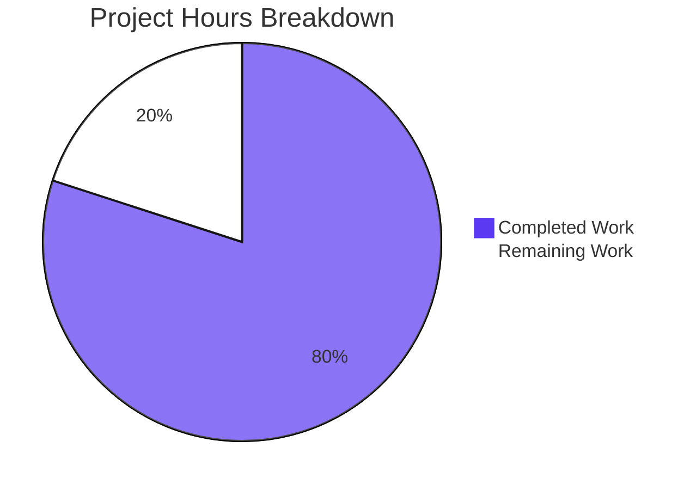
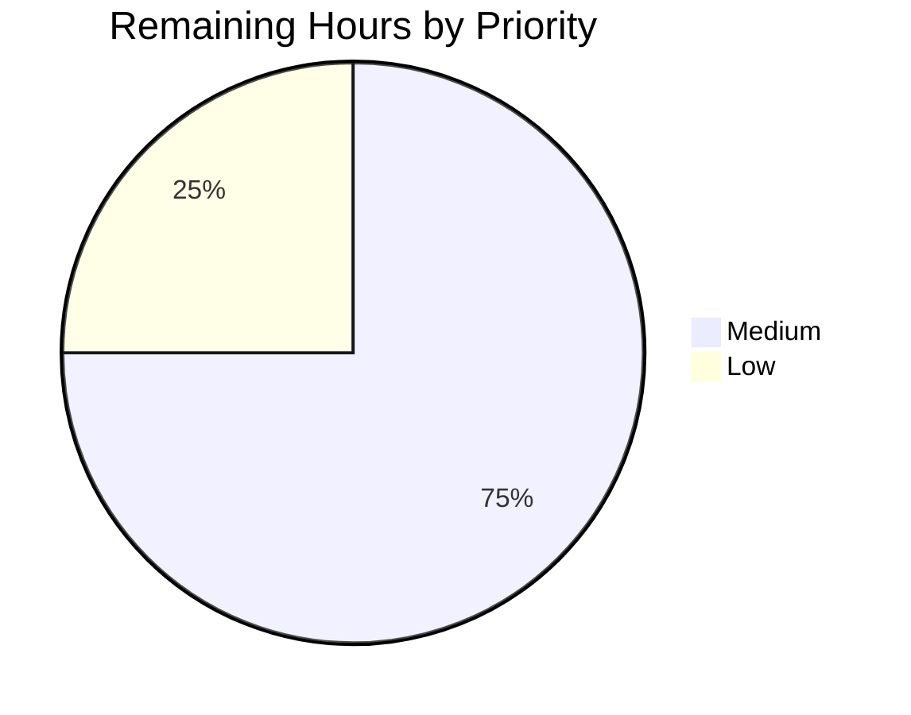

# 1. Executive Summary

## 1.1 Project Overview

A single-file Node.js command-line program that writes one unformatted line — `Welcome to Blitzy` — to standard output, with a four-line README carrying the install and run instructions. Its audience is the developer who clones the repository and runs one command from a shell, and any automated check that reads the program's output line. There is no dependency, no manifest, no configuration surface, no endpoint and no user interface: nothing is installed and nothing is deployed, and `node index.js` prints the line and exits 0. The scope is a prototype-grade proof of concept, with production scaffolding excluded by the request.

## 1.2 Completion Status

**80% complete** — 8.0 of 10.0 hours. Dark Blue marks delivered work; White marks what remains.



| Metric | Hours |
|--------|-------|
| Total Hours | 10.0 |
| Completed Hours (AI + Manual) | 8.0 |
| Remaining Hours | 2.0 |

Completion calculation: 8.0 completed ÷ (8.0 completed + 2.0 remaining) = **80.0%**.

## 1.3 Key Accomplishments

- [x] `Welcome to Blitzy` printed to stdout unformatted — 18 bytes, one line, exit 0 (`index.js:2`)
- [x] Zero-install, zero-configuration execution: no manifest, lockfile, dependency, environment variable, flag or config file
- [x] Deterministic output — a 25-run loop and every invocation form produced one identical value
- [x] Two run forms resolve to the program: `node index.js` and the manifest-free `node .`
- [x] Both files byte-identical to specification, with install and run instructions in a four-line README (`README.md:3-4`)
- [x] Minimal footprint: two files, one comment, one statement, no handler, no logging, no hardening

## 1.4 Critical Unresolved Issues

3 of 23 tracked requirements carry an open caveat; no requirement is unimplemented.

| Issue | Impact | Owner | ETA |
|-------|--------|-------|-----|
| The documentation names the Node.js 24 LTS line; the program has been run only on Node.js 22.23.3 (`README.md:3`) | The release-line claim is asserted from specification rather than measured on the named line | Release owner | Before release |
| The release-line sentence is dated by construction and reads stale as the Active LTS line advances | Documentation accuracy degrades over time | Release owner | At the next release-line change |
| With stdout on an unwritable device, a closed descriptor or an early-closing reader, the process exits 0 with nothing on stderr | A consumer checking only the exit status cannot detect a dropped write; accepted because an error handler is excluded | Application owner | Accepted — no action unless the requirement changes |

## 1.5 Access Issues

No access issues identified. The program reads no credential, connects to no service and needs no registry or third-party access beyond the checkout itself.

## 1.6 Recommended Next Steps

1. [Medium] Run the two documented commands on the Node.js release line the documentation names, recording the observed bytes and exit status.
2. [Medium] Review the release-line sentence in `README.md:3` and decide whether to generalise it.
3. [Low] Agree the change gate for any future edit to `index.js`: the executable gate plus a byte-for-byte comparison of both files.
4. [Low] Decide whether the prohibition on a test suite still holds; today no regression net exists.

# 2. Project Hours Breakdown

## 2.1 Completed Work Detail

| Component | Hours | Description |
|-----------|-------|-------------|
| Program file `index.js` — output contract | 1.5 | The two-line program: one one-line summary and one `console.log` call emitting the unformatted line (`index.js:1-2`) |
| Zero-install, configuration-free execution and path resolution | 1.5 | No manifest, lockfile, dependency, configuration or argument surface; both `node index.js` and the manifest-free `node .` resolve to the program |
| Deterministic, clean-stream behaviour | 2.0 | Identical output across repeated runs, empty and hostile environments, junk argument lists and every destination tested; empty stderr and exit 0 throughout |
| Install and run documentation | 0.5 | The four-line `README.md` carrying one install line and one run line that quotes the command and its exact output |
| Prohibition and minimalism compliance | 0.75 | A two-file tree: no test suite, manifest, lockfile, configuration, handler, logging or unrequested hardening |
| Byte-exact acceptance verification | 1.25 | Both files compared with their specified content and their digests recorded; the whole change is those two paths |
| Comment, style and structure conventions | 0.5 | One one-line comment with no tags, double-quoted literal, terminating semicolon, single trailing newline, both files at the repository root |
| **Total** | **8.0** | |

## 2.2 Remaining Work Detail

| Category | Hours | Priority |
|----------|-------|----------|
| Release-runtime verification on the Node.js line the documentation names | 1.0 | Medium |
| Documentation-currency decision for the dated release-line sentence | 0.5 | Medium |
| Regression-guard confirmation before any future edit to the program | 0.5 | Low |
| **Total** | **2.0** | |

Section 2.1 (8.0 hours) plus Section 2.2 (2.0 hours) equals the Total Hours of 10.0 in Section 1.2, and the 2.0 remaining hours are the value carried in Sections 1.2 and 7.

# 3. Test Results

The project ships no test suite, test file, runner or coverage tooling — none exists and none may be added, because the request prohibits a test suite, a lockfile and any dependency. Verification is therefore executable: each row below is a command that was run against the delivered files and whose output was inspected. Node.js 22.23.3 was the runtime under test.

| Area / Category | Framework | Tests | Passed | Failed | Coverage | What This Proves |
|-----------------|-----------|-------|--------|--------|----------|------------------|
| Output contract — `node index.js` from the repository root | None (direct execution) | 1 run | 1 | 0 | Not measured | One unformatted line of 18 bytes on stdout, 0 bytes on stderr, exit 0 |
| Executable validation gate — `node --check index.js`, output assertion, README line cap | Node.js parse check and shell assertions | 3 checks | 3 | 0 | Not measured | The program parses cleanly, prints the documented line, and the documentation stays within its line cap |
| Invocation forms — manifest-free `node .`, empty environment, junk argument list | None (direct execution) | 3 runs | 3 | 0 | Not measured | The program needs no manifest, no configuration, no environment variable and no arguments |
| Determinism — 25 consecutive runs | None (direct execution) | 25 runs | 25 | 0 | Not measured | Repeated runs produce one identical value and leave no file, socket or process behind |
| Failure and recovery — missing entry path, then a normal run | None (direct execution) | 2 runs | 2 | 0 | Not measured | Only the runtime's own `MODULE_NOT_FOUND` diagnostic appears, and the next run is unaffected |
| Adversarial sinks — unwritable stdout, closed descriptor, early-closing reader | None (direct execution) | 3 runs | 3 | 0 | Not measured | Output failure is silent by design; the process still exits 0 |
| Byte-exact content — both delivered files against their specified content | `diff` | 2 comparisons | 2 | 0 | Not measured | `index.js` (79 bytes) and `README.md` (180 bytes) match their specified bytes exactly |
| Absence compliance — prohibited artifacts, test and coverage paths, placeholders, forbidden constructs | Shell sweeps | 4 sweeps | 4 | 0 | Not measured | No test suite, manifest, lockfile, configuration, handler or unfinished work exists anywhere in the tree |

### Not Covered

- **No automated regression net.** No test suite, runner or coverage tooling exists and none may be added, so the checks above are the whole of the executable verification and no coverage figure can be reported. Any future edit to the program is unguarded by tests.
- **The documented release line has not been run.** The documentation names the Node.js 24 LTS line; the program has been executed on Node.js 22.23.3 only. Before release, run `node --check index.js`, `node index.js` and the executable gate on the named line and confirm the same 18 bytes and exit 0.
- **The working-tree permission on `README.md`** is narrower than on `index.js`. Git records both as `100644`, so a fresh checkout is unaffected; a verification of the checked-out tree should confirm the file is world-readable if the repository is served directly rather than cloned.
- **Nothing browser-, API-, database- or network-facing is exercised, or needs to be.** No user interface, endpoint, route, port, schema, message channel or outbound call exists, so there is no such surface to test and no integration mock to maintain.

# 4. Runtime Validation & UI Verification

The program is a terminal-only artifact: it has no user interface, no rendered output, no endpoint and no outbound call, so the flows below were driven from a shell in the repository checkout and every observation is process-level — exact stdout bytes, byte counts, digest, stderr size and exit status.

- ✅ **Program start and termination** — `node index.js` starts, prints and exits 0 in roughly 25–30 ms; three timeout-wrapped runs returned 0, never a timeout status, so it never hangs.
- ✅ **Output contract** — exactly 18 bytes on one line (`Welcome to Blitzy` plus the printing call's newline), 0 bytes on stderr, exit 0, with no colour, escape, quote, label or suffix.
- ✅ **Manifest-free invocation** — `node .` from the repository root prints stdout byte-identical to `node index.js` and exits 0, resolving to the same file through the runtime's directory-as-module fallback.
- ✅ **Configuration independence** — a completely empty environment (`env -i`) prints the identical 18 bytes with exit 0; no environment variable, flag or config file influences the run.
- ✅ **Argument independence** — a junk argument list (`foo --help -x`) prints the identical 18 bytes with exit 0, confirming nothing is parsed.
- ✅ **Determinism and side-effect freedom** — 25 consecutive runs produced a single distinct value; no file, socket or process was created or left behind, and the working directory was unchanged after every run.
- ✅ **Failure and recovery** — a missing entry path exits 1 with the runtime's own `MODULE_NOT_FOUND` diagnostic and nothing on stdout, and the next run reproduces the correct line.
- ⚠ **Output failure to an unwritable sink** — with stdout directed to an unwritable device, to a closed descriptor, or to a consumer that closes early, the process exits 0 with nothing on stderr, so a dropped write is invisible to a caller that inspects only the exit status. Accepted by design: an error handler is excluded by the request.
- ⚠ **Documented release line** — the documentation names the Node.js 24 LTS line, and the program has been run on Node.js 22.23.3 only; the program encodes no version check or engine constraint, so its behaviour is release-independent, but the claim itself is not yet measured on the named line.

**Never exercised at runtime, because none is built:** no browser or screen surface, no HTTP endpoint or listening port, no database, queue, cache or message channel, no webhook, no authentication or authorization flow, no third-party integration, and no outbound network call. The program binds no port and defines no container, so there is no service to start, seed or tear down.

# 5. Compliance & Quality Review

## 5.1 Compliance Matrix

| Deliverable | Benchmark | Status | Evidence |
|-------------|-----------|--------|----------|
| Program file `index.js` — unformatted output | Correct output, no formatting or colour | ✅ PASS | 18 bytes on stdout, 0 on stderr, exit 0 (`index.js:2`) |
| Program structure — two lines, one summary, one statement | Minimalism; no scaffolding or indirection | ✅ PASS | 2 lines, 1 comment, 1 statement, 0 blank lines, 0 imports, 0 wrappers |
| Installation-free execution | No install, build, argument or configuration step | ✅ PASS | No manifest, lockfile or package tree; junk-argument and empty-environment runs identical |
| Repository entry point and documentation | One entry file plus a README within its five-line cap | ✅ PASS | `index.js` at the root; `README.md` 4 lines, 1 heading, 1 blank line |
| Dependency and manifest exclusion | No third-party dependency, manifest or lockfile | ✅ PASS | Sweeps for manifests, lockfiles and installed package trees returned nothing |
| Configuration-surface exclusion | No environment variable, config file or flag | ✅ PASS | No environment read, no config file, no flag parsing anywhere in the tree |
| Deterministic output and zero exit code | Same line every run, successful termination | ✅ PASS | 25-run loop — one distinct value; exit 0 on every invocation form |
| Documentation accuracy | Documented command reproduces the documented line | ✅ PASS | Following `README.md:4` from the root produced the quoted line byte for byte |
| Byte-exact acceptance | Both files match their specification exactly | ✅ PASS | `index.js` 79 bytes, `README.md` 180 bytes, digests recorded, `diff` clean |
| Minimal change scope | No unrelated refactoring, reformatting or renaming | ✅ PASS | Two paths changed, 6 insertions, 2 deletions, no rename, no mode change |
| Comment and convention compliance | One one-line summary, no tags; language conventions where silent | ✅ PASS | Comment count 1, no `@` tags, double-quoted literal, terminating semicolon, trailing newline |
| Input, secret and injection surface | No attacker-reachable surface | ✅ PASS | No input read, no socket, no secret, no shell or evaluation sink, no third-party code |

## 5.2 AAP & Rule Divergences and Gaps

| What the AAP/Rule Required | What Was Delivered Instead | Why It Diverged | Impact | Remediation |
|----------------------------|---------------------------|-----------------|--------|-------------|
| "Ensure to use as less lines as possible by optimizing token usage" — read literally, a one-line program | A two-line program: the one-line comment plus the statement (`index.js:1-2`) | The same request caps the JSDoc comment at one line, which presupposes the comment exists; the two instructions cannot both hold at one line, and the reading that honours both keeps the comment | One extra source line; no behavioural difference | None required. Reopen only if a one-line program is preferred — that is a specification change, not a defect fix (Sanctioned) |
| "Do not create any other file" — no CONTRIBUTING.md, CHANGELOG.md, LICENSE, docs folder, diagrams or badges | `README.md` exists at the repository root, four lines (`README.md:1-4`) | The prohibition enumerates files other than the README, while the same request caps `README.md` and requires the install and run instructions to be written somewhere; the specific instruction outranks the general one | None; the README is required by the request's own line cap | None required (Sanctioned) |
| The plan describes the repository as holding no files and maps both deliverables as newly created | `index.js` was added; `README.md` was rewritten in place over a pre-existing two-line placeholder | The plan's premise about the starting repository was inaccurate; the documentation file was already tracked at commit `cc851ce`, and its bytes were fixed by the plan, so it was rewritten rather than created | The change reads as one addition plus one in-place rewrite rather than two additions; the delivered end state is unchanged | None in code. Read `git diff cc851ce..HEAD` as `A index.js` plus `M README.md` when comparing the change against the plan |
| No verification, coverage or quality-criteria section, and no test-style acceptance criteria, in the plan | The governing plan carries a Quality Standards sub-section | The authoring contract requires that sub-section; it was reduced to what the request allows — the exact file contents as the acceptance criterion, with no digest check, command table, metric or test-style criterion | None in the repository: neither delivered file carries such a section | None required (Sanctioned) |

**Line count versus token minimalism.** The request asks for the fewest lines that print the message and, in the same breath, caps the JSDoc comment at one line — which presupposes a comment exists. Those two directives cannot both hold at a single line, so the delivery kept the comment and shipped a two-line program (`index.js:1-2`, 79 bytes, one comment, one statement). Its behaviour is exactly what was asked for: one unformatted line on stdout and nothing else; the cost is one source line. Deleting line 1 would reach the literal minimum, but that amends the agreed specification rather than correcting a defect, so no change should be made without that decision.

**The README and the "no other file" prohibition.** The prohibition lists CONTRIBUTING.md, CHANGELOG.md, LICENSE, a `docs/` folder, architecture diagrams and badges; it does not name `README.md`. The same request caps `README.md` at under five lines and requires accurate install and run instructions for the repository as it exists today, which can only live in the README. Four lines at the repository root (`README.md:1-4`: title, blank line, one install line, one run line) satisfy both the cap and the instruction, and no other file was created anywhere. The specific instructions about the README therefore outrank the general prohibition, and the tree holds exactly the two files the work was scoped against.

**The starting repository did not match the plan's premise.** The plan describes a repository holding no files and maps both deliverables as new. The checkout contradicted that: `README.md` was already tracked as a two-line placeholder at commit `cc851ce`. Because the plan put it in scope and fixed its bytes, it was rewritten in place (4 insertions, 2 deletions), while `index.js` was added in `afab7e1` and the rewrite landed in `3c4bf2a`. The delivered end state is unaffected: two files at the root with their specified contents. The divergence is in the plan's description of the starting state, not in the work, and needs no code change — only that a reviewer reads it as one addition and one in-place rewrite.

**The plan's own structure against the request's form constraint.** The request excludes a verification, coverage or quality-criteria section from the delivery's planning document, while the authoring contract governing it mandates a Quality Standards sub-section. That sub-section was kept and cut back to what the request permits: the exact file contents and the smallest possible diff as the acceptance standard, with no digest check, table, metric or test-style criterion. The substance the request objected to is therefore absent, and the divergence leaves no footprint in the repository: neither delivered file carries such a section. No further action is required; it is recorded so the plan's shape is not mistaken for a departure in the artifact.

# 6. Risk Assessment

| Risk | Category | Severity | Probability | Mitigation | Status |
|------|----------|----------|-------------|------------|--------|
| A write to an unwritable or early-closed stdout is silent: the process exits 0 with nothing on stderr, so a caller inspecting only the exit status cannot tell the line was dropped | Operational | Low | Low | Consumers validate the captured stdout content rather than the exit status alone; add a handler only if the request's prohibition on error handling is lifted | Accepted by design |
| The documentation's release-line sentence drifts as the Active LTS line advances, and the README then understates or misstates what the program runs on | Operational | Low | High | Review that one line at each Node.js release-line change; any edit is a specification change because the file's bytes are the acceptance standard | Open |
| No automated regression net exists — no test suite, runner or coverage tooling may be added — so a future edit to `index.js` can break the output contract undetected | Technical | Medium | Medium | Treat every edit to the program as a specification change and re-run `node --check index.js`, `node index.js` and the executable gate before merging | Accepted by design |
| The documented release line has never been exercised: the README names the Node.js 24 LTS line while the program has run on Node.js 22.23.3 only | Technical | Low | Low | Run the two documented commands on the named line and record the observed bytes and exit status before release | Open |
| The documented command resolves only when run from the repository root; a reader elsewhere sees the runtime's module-resolution failure instead of the line | Operational | Low | Medium | Run the command from the repository root as the documentation states; the README has one line of slack under its cap if this needs restating | Accepted |
| The program's only prerequisite is a Node.js runtime on the host; a host without one cannot run it, and no engine constraint or version check is encoded | Integration | Low | Low | State the prerequisite when distributing the repository, as `README.md:3` already does; install a supported Node.js release on the target host | Accepted |
| The working-tree permission on `README.md` is narrower than on `index.js` in this checkout | Operational | Low | Low | Rely on the clone: git records both files as `100644`, so a fresh checkout materialises world-readable files | Accepted |

No security risk is carried. The program reads no input, opens no socket, holds no secret, persists nothing and depends on no third-party code, so there is no attacker-reachable surface, no credential to leak and no supply-chain path to compromise. The only failure the runtime can reach, a wrong or missing entry path, exits non-zero with the runtime's own diagnostic and leaves nothing inconsistent behind.

# 7. Visual Project Status

**Project hours — AAP-scoped completion**


**80% complete** — 8.0 hours delivered of 10.0 total.

**Remaining work by priority**



**Remaining hours per category**

| Category | Hours | Priority |
|----------|-------|----------|
| Release-runtime verification on the documented Node.js line | 1.0 | Medium |
| Documentation-currency decision for the dated release-line sentence | 0.5 | Medium |
| Regression-guard confirmation before any future edit | 0.5 | Low |
| **Total** | **2.0** | |

**Status key** — the palette used throughout this guide: Completed / delivered work is Dark Blue `#5B39F3`; remaining / not completed work is White `#FFFFFF` outlined in Violet-Black `#B23AF2`; headings and accents are Violet-Black `#B23AF2`; highlights are Mint `#A8FDD9`.

# 8. Summary & Recommendations

The project is **80% complete** against its agreed scope: 8.0 of 10.0 hours delivered, 2.0 remaining. All 23 tracked requirements are met in the delivered code — nothing is unimplemented — and the remaining hours are release-readiness work rather than missing functionality. A two-line program at the repository root prints exactly one unformatted line, `Welcome to Blitzy`, to stdout; a four-line README carries the repository's install and run instructions. Both files are byte-identical to their specification, `index.js` at 79 bytes and `README.md` at 180 bytes, and the whole change is those two paths: 6 insertions and 2 deletions across one addition and one in-place rewrite.

What was exercised confirms the deliverable end to end. The program was run from the repository root and from the manifest-free `node .` form, under a completely empty environment set and under a junk argument list, each time producing the same 18 bytes on stdout, nothing on stderr and exit status 0. A 25-run loop produced one identical value, with no file, socket or process left behind and the working directory unchanged. The parse check and the executable validation gate both pass, and a byte-for-byte comparison confirms both files match their specified content. The one failure the runtime can reach — a wrong or missing entry path — exits 1 with the runtime's own `MODULE_NOT_FOUND` diagnostic alone, and the next run reproduces the correct line.

The residual work is small and specific. The documentation names the Node.js 24 LTS line while the program has been exercised on Node.js 22.23.3, so the release-line claim should be measured on the named line before release (1.0 hour). The release-line sentence is dated by construction and will read stale as the Active LTS line advances, so it needs a currency decision (0.5 hour). Finally, because a test suite, lockfile and dependency are all prohibited, no automated regression net exists; agreeing what gates a future edit to the program (the parse check, the run, the executable gate and a byte comparison) takes 0.5 hour.

The critical path to production is therefore short and has no engineering obstacle: run the two documented commands on the documented runtime, settle the wording of the one dated line, and record the change gate. Nothing in the delivered code blocks release, and the two silent-failure behaviours that remain — output to an unwritable sink exiting 0, and a run started outside the repository root failing to resolve the file — are both accepted consequences of the request's own constraints rather than defects.

**Production readiness:** ready to release within this artifact's explicitly prototype-grade, request-bounded scope. Success metrics for this delivery are the output contract (exactly 18 bytes on one line, empty stderr, exit 0), the two-file tree (no dependency, manifest, lockfile, configuration or handler), the byte-exact acceptance of both files, and the two run forms resolving to the same program. All four hold today. The features a production system would carry — tests, dependency management, configuration, logging, error handling and hardening — are the request's mandated exclusions, so their absence is correctness here, not incompleteness; the caveat a reader should carry forward is that any future edit to the program is unguarded by tests and must be verified by re-running the documented commands.

# 9. Development Guide

### System Prerequisites

- **A Node.js runtime** — the only requirement. The project declares no package, so no version is pinned and no engine constraint is encoded; every command below was run and verified on **Node.js v22.23.3**.
- No compiler, build tool, package manager, database, broker, container runtime or service is needed. No npm, yarn or pnpm is used at any point.
- Any operating system with a POSIX shell and Node.js works; both files are LF-terminated ASCII.

```bash
# Confirm the runtime is present and report its version
node --version
```

Expected: a version string such as `v22.23.3`.

### Environment Setup

There is nothing to configure. The program reads no environment variable, no configuration file and no command-line flag, and it runs correctly under a completely empty environment. All commands run from the repository root; no virtual environment, no environment file and no credential is required.

```bash
# Change to the repository root — every command below assumes you are here
cd "$(git rev-parse --show-toplevel)"
pwd
```

### Dependency Installation

**No install step exists.** The repository has no dependency manifest, no lockfile and no installed package tree, and the program's only call targets a Node.js built-in. Do not run `npm install`, `npm init`, `yarn` or `pnpm`; creating a manifest, a lockfile or a `node_modules` directory would break the project's stated constraints.

```bash
# Confirm that nothing needs installing — all three probes must report "No such file or directory"
ls package.json package-lock.json node_modules
```

### Application Startup

The program is a single-file script with no server, no port, no background process and no warm-up. Running it is the whole operation.

```bash
# Run the program from the repository root
node index.js
```

Expected output — one line, nothing else:

```text
Welcome to Blitzy
```

The process exits with status 0 and writes nothing to stderr. An equivalent, manifest-free invocation resolves to the same file:

```bash
# Directory form: the runtime's index fallback resolves to index.js
node .
```

Expected: the same single line, `Welcome to Blitzy`.

### Verification Steps

Each command below was run against the delivered files and its result was observed.

```bash
# 1. Parse check — the file must parse without executing
node --check index.js
# Expected: no output, exit status 0

# 2. Output assertion — stdout must be exactly the documented line
test "$(node index.js)" = "Welcome to Blitzy" && echo OUTPUT_OK
# Expected: OUTPUT_OK

# 3. Byte-exact comparison — stdout must be 18 bytes with one trailing newline
node index.js | cmp - <(printf 'Welcome to Blitzy\n') && echo CAPTURE_MATCHES
# Expected: CAPTURE_MATCHES

# 4. Executable gate — parse check, output assertion and the README line cap in one command
node --check index.js && test "$(node index.js)" = "Welcome to Blitzy" && [ "$(wc -l < README.md)" -le 5 ] && echo GATE_PASS
# Expected: GATE_PASS

# 5. Environment independence — the run must not depend on any configuration
env -i /usr/bin/node index.js
# Expected: Welcome to Blitzy

# 6. Determinism — repeated runs must produce one identical value
for i in $(seq 1 25); do node index.js; done | sort -u
# Expected: exactly one line, Welcome to Blitzy
```

### Example Usage

The program takes no arguments and produces no side effects; it is designed to be run and read.

```bash
# Inspect the output's size and digest without writing a file into the repository
node index.js | wc -c
# Expected: 18
node index.js | sha256sum
# Expected: 2dc7e85a734de043468d7beb8ee5294e0c04440f23fd89b69fd8ea0ee7971951  -

# Use it as an automated check in a script — non-zero status on mismatch
node index.js | grep -qx 'Welcome to Blitzy' && echo CHECK_PASS || echo CHECK_FAIL

# Confirm the two documented files are the whole repository content
git ls-files
# Expected: README.md and index.js, nothing else
```

### Troubleshooting

| Symptom | Cause | Resolution |
|---------|-------|------------|
| `Error: Cannot find module '/index.js'` with exit status 1 | The command was run from a directory that does not hold the file | `cd` to the repository root first; the documented command is root-relative |
| `node: command not found` | No Node.js runtime on the host | Install a supported Node.js release and re-run `node --version` |
| Nothing appears on stdout when the output is piped | The consumer closed the pipe before the write completed | Expected: the write is silent on failure and the process still exits 0; read the output before closing the reader |
| An extra carriage return appears in a terminal capture | The terminal driver translates the newline it receives | Not program output — pipe to `cmp` or `od -c` to see the raw 18 bytes |
| `No such file or directory` from `ls package.json …` | Expected — no manifest, lockfile or package tree exists | None; do not create one |
| `README.md` looks narrower-permissioned than `index.js` in a working tree | A file-writer's umask in this checkout | Git records both as `100644`; a fresh clone materialises world-readable files |
| The output line contains colour or an escape sequence | Another process wrote to the same stream | The program passes a single plain string to the runtime's print call, which applies no formatting to it |

### Stopping the Application

Nothing to stop. The program binds no port, opens no socket, starts no service and leaves no process behind, so no shutdown, container teardown or cleanup command is needed.

# 10. Appendices

## A. Command Reference

| Purpose | Command | Expected result |
|---------|---------|-----------------|
| Report the runtime version | `node --version` | A version string, e.g. `v22.23.3` |
| Confirm nothing needs installing | `ls package.json package-lock.json node_modules` | Three "No such file or directory" messages |
| Run the program | `node index.js` | `Welcome to Blitzy`, exit 0, empty stderr |
| Run without a manifest | `node .` | `Welcome to Blitzy`, exit 0 |
| Run without configuration | `env -i /usr/bin/node index.js` | `Welcome to Blitzy`, exit 0 |
| Parse check (does not execute) | `node --check index.js` | No output, exit 0 |
| Assert the exact output | `test "$(node index.js)" = "Welcome to Blitzy" && echo OUTPUT_OK` | `OUTPUT_OK` |
| Byte-exact comparison of stdout | `node index.js \| cmp - <(printf 'Welcome to Blitzy\n') && echo CAPTURE_MATCHES` | `CAPTURE_MATCHES` |
| Executable gate | `node --check index.js && test "$(node index.js)" = "Welcome to Blitzy" && [ "$(wc -l < README.md)" -le 5 ] && echo GATE_PASS` | `GATE_PASS` |
| Determinism check | `for i in $(seq 1 25); do node index.js; done \| sort -u` | Exactly one line, `Welcome to Blitzy` |
| Byte and digest check | `wc -c < index.js; sha256sum index.js README.md` | `79`; `2820a73c…` and `1c80eb05…` |
| Confirm the repository content | `git ls-files` | `README.md` and `index.js` |

## B. Port Reference

No port is bound, listened on or connected to. The program opens no socket, and neither delivered file references a network module, so there is no port to allocate, reserve or firewall on any environment.

## C. Key File Locations

| Path | Role |
|------|------|
| `index.js` | The program: a one-line summary and one print statement, two lines, 79 bytes |
| `README.md` | The install and run instructions: title, blank line, one install line, one run line, 180 bytes |

There are no other files. No test directory, source folder, configuration directory, documentation folder or build output exists, and none is expected.

## D. Technology Versions

| Component | Version | Notes |
|-----------|---------|-------|
| Node.js (runtime under test) | v22.23.3 | A Maintenance LTS line; the only prerequisite |
| Node.js (documented line) | 24 LTS | Named as the current Active LTS line in `README.md:3`; the program encodes no version check |
| JavaScript module mode | CommonJS | Implied by the `.js` extension with no parent manifest; no `type` field, no `.mjs` or `.cjs` |
| Dependency tree | none | No manifest, no lockfile, no installed packages; the only call targets a runtime built-in |

## E. Environment Variable Reference

None. The program reads no environment variable, and the repository ships no environment template or configuration file. A run under a completely empty environment (`env -i`) produces the same line and exit status as a normal run.

## F. Developer Tools Guide

| Tool | Use |
|------|-----|
| `node` | Run the program and its parse check; the only tool the project requires |
| `git` | Inspect the change (`git log --oneline`, `git diff cc851ce..HEAD`, `git show --stat <commit>`) — the change is two paths: `index.js` added, `README.md` rewritten in place |
| `wc` | Check the line and byte budgets: `wc -l -c index.js README.md` → `2 79` and `4 180` |
| `sha256sum` | Compare the delivered files against their recorded digests: `2820a73c…` for `index.js`, `1c80eb05…` for `README.md` |
| `cmp` / `diff` | Compare captured stdout or a file against its expected bytes |
| `od -c` | Inspect the raw bytes of the output or of a file when a whitespace or encoding question arises |

No linter, formatter, bundler, type checker, test runner or CI workflow is configured, and none may be added without changing the project's stated constraints. Any change to the program should be verified with the parse check, the run, the executable gate and a byte-for-byte comparison of both files.

## G. Glossary

| Term | Meaning |
|------|---------|
| AAP-scoped completion | Completion measured only against the agreed scope — the deliverables the plan defines and the path to releasing them — expressed as completed hours over total hours |
| Acceptance standard | The exact contents of both files as the criterion the work is judged against, together with the smallest possible diff |
| CommonJS | The module system a `.js` file uses when no parent manifest declares otherwise; the mode this program runs in without any declaration |
| Executable gate | The single command that parses the program, asserts its exact stdout line and checks the documentation's line cap |
| Manifest-free form | Running the program as a directory (`node .`), which resolves to `index.js` through the runtime's folder-as-module fallback |
| Output contract | The behaviour a consumer can rely on: exactly 18 bytes on stdout — `Welcome to Blitzy` plus one newline — nothing on stderr and exit status 0 |
| Path to production | The release-readiness work that remains after the deliverables are complete: verifying on the documented runtime line, settling the dated documentation sentence and agreeing the change gate |
| Remaining hours | Estimated effort still outstanding against the agreed scope, expressed in engineering hours |
| Two-file tree | The repository content as delivered: `index.js` and `README.md`, with no dependency, manifest, lockfile, configuration or test artifact |
